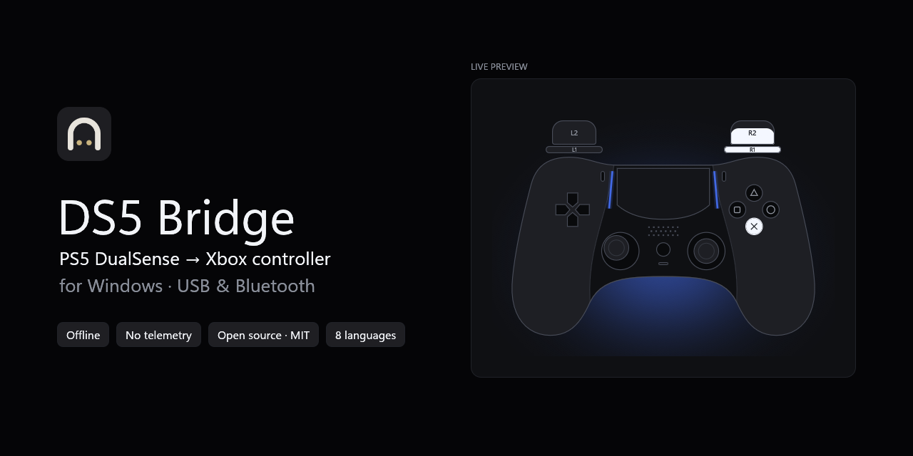
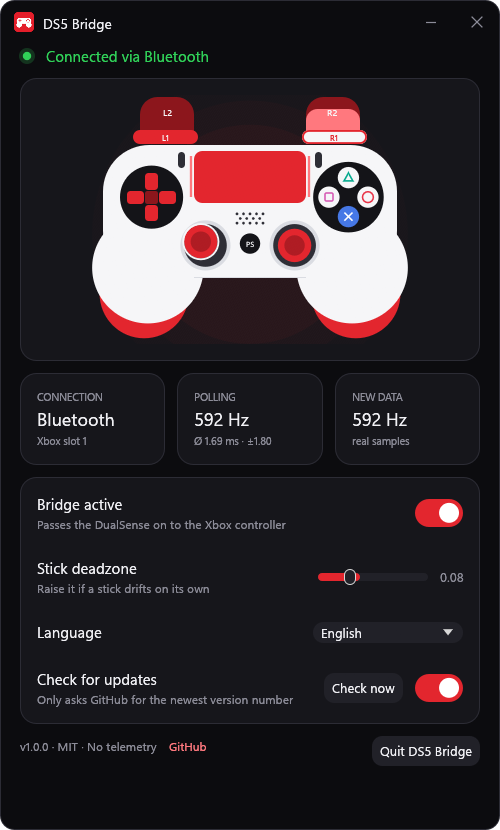
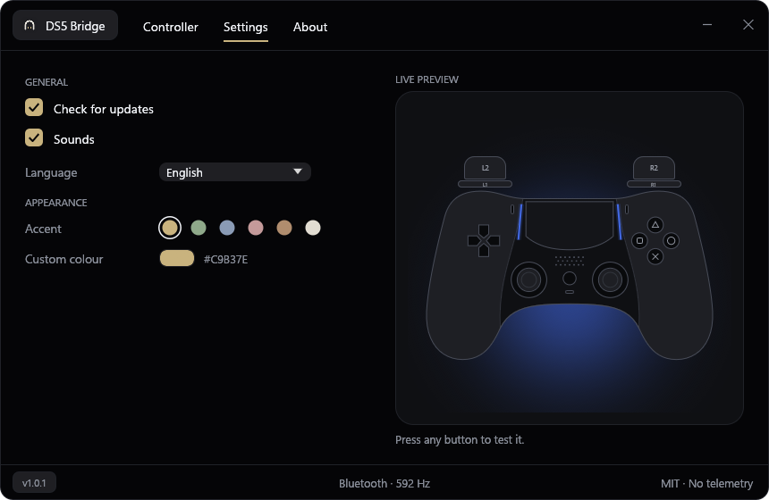
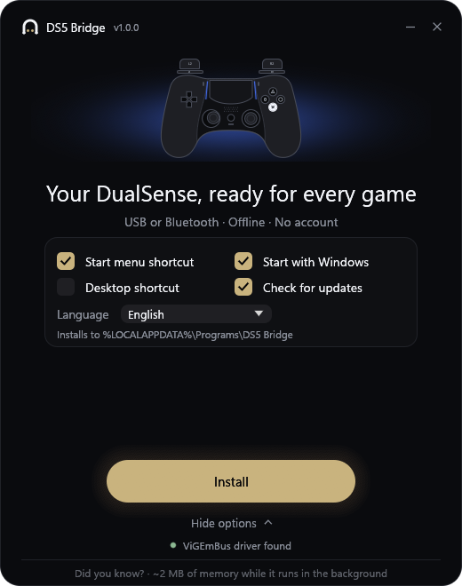

<p align="center">
  
</p>

<p align="center">
  <a href="https://github.com/aywalh/ds5bridge/releases/latest"></a>
  
  
  
</p>

**DS5 Bridge** lets you use a **PS5 DualSense** as an **Xbox controller** on Windows, over **USB or Bluetooth**.
Games see a normal Xbox 360 controller (XInput), so the DualSense works everywhere an Xbox pad works.

One small exe, written in Rust. No account, no telemetry, fully offline.

## Why this exists

I plugged a PS5 controller into my PC and it just didn't work in my games. Over Bluetooth it kept
connecting and dropping. The usual fixes meant big launchers running in the background, accounts or
tools that phone home. I didn't want any of that.

So I built the smallest thing that works. DS5 Bridge reads the DualSense directly through Windows'
own HID API and hands every button, stick and trigger to a virtual Xbox controller. Games then simply
see an Xbox pad. It runs quietly in the tray, starts with Windows if you want, and never touches
the internet except to ask GitHub whether there is a new version (you can turn that off).

## Features

- **USB and Bluetooth.** Over Bluetooth it switches the DualSense into its full report mode.
- **Live preview.** A drawn DualSense that lights up with every button, stick and trigger you press.
- **Polling rate you can choose:** Auto (every report, about 250 Hz over USB and 600 Hz over
  Bluetooth) or a fixed 500, 250 or 125 Hz, with the measured rate and jitter shown live.
- **Stick deadzone** slider against drift, with soft detent clicks (can be turned off).
- **Your colours:** six calm accent presets or any colour you pick.
- **Lives in the tray.** Closing the window keeps the bridge running at about **2–3 MB of RAM**
  and **well under 1 % CPU**.
- **A one-button installer** (options fold out when you want them, with little facts about the app), plus updater and uninstaller. Per user, no admin rights.
- **Updates you can trust:** a new version is installed only if its SHA-256 matches the checksum
  published on GitHub.
- **8 languages:** English, Deutsch, 日本語, 简体中文, 한국어, Tiếng Việt, Filipino, العربية.

## Screenshots

<p align="center">
  
  
</p>
<p align="center">
  
  
</p>
<p align="center">
  
</p>

## Install

1. Install the **[ViGEmBus driver](https://github.com/nefarius/ViGEmBus/releases)** (open source, by Nefarius).
   It is what creates the virtual Xbox controller. DS5 Bridge tells you if it is missing.
2. Download **`DS5Bridge.exe`** from the [latest release](https://github.com/aywalh/ds5bridge/releases/latest) and run it.
3. Pick your options in the installer and click **Install**. DS5 Bridge starts in the tray (bottom right).

The exe is not code-signed, so Windows SmartScreen may warn the first time: *More info → Run anyway*.
You can check the download against `DS5Bridge.exe.sha256` from the same release.

**Updates:** DS5 Bridge checks GitHub at most every few hours (or when you click *Check now* under
*About*). If a new release is there, *Update now* downloads it, verifies the SHA-256 and restarts.

**Remove:** *Settings → Apps → Installed apps → DS5 Bridge → Uninstall*. That removes the app,
its shortcuts, the autostart entry and its settings.

**Portable:** download **`DS5Bridge-portable.exe`** instead and just run it. Nothing is installed (or run `DS5Bridge.exe --portable`).

## Privacy

DS5 Bridge has **no telemetry, no account and no analytics**. It reads the controller locally and
talks to a local driver. That's all.

The only network access is the **update check**, and only while it is enabled: it asks
`api.github.com` for the newest release of this repository and, if you click *Update now*,
downloads it from GitHub. No identifiers are sent.

Settings are stored in `%APPDATA%\DS5 Bridge\settings.ini`. The app is installed to
`%LOCALAPPDATA%\Programs\DS5 Bridge`.

## Polling rate

Measured with the built-in live view on a standard DualSense:

| Connection | Reports per second | Typical interval | Jitter |
|---|---|---|---|
| USB | 250 Hz | 4.00 ms | ~0.05 ms |
| Bluetooth | ~590 Hz | ~1.7 ms | ~1.8 ms |

Over USB the DualSense itself asks Windows to poll it every 4 ms. Going faster over USB (1 ms)
needs a kernel filter driver that rewrites that value. DS5 Bridge deliberately does not install
drivers, so *Auto* is the fastest it gets without one. Lower fixed rates are there if you want them.
The **New data** row counts only reports with a new timestamp from the controller, so you can see
whether a higher rate really brings fresher input.

## How it works

- `DS5Bridge.exe --background` is the tray service: plain Win32, no UI toolkit loaded.
  It reads the DualSense through the Windows HID API and feeds a virtual Xbox 360 controller through
  the ViGEmBus driver's own IOCTL protocol (no extra DLL). It only talks to the driver when the
  input actually changed, and wakes the window the moment it does.
- The window is a separate process (`--ui`, built with [egui](https://github.com/emilk/egui)).
  It reads the live state from a small shared-memory block and exits completely when closed.
- The controller, the logo and the icon are drawn in code. No images from anyone else.
- Everything else is the Rust standard library and Windows' own DLLs. The only crate is `eframe`.

## Build from source

```powershell
cargo test
cargo build --release
```

The exe is `target\release\ds5bridge.exe`. `docs\render.ps1` redraws the README images from the app
itself (with demo values).

**Releasing:** bump `version` in `Cargo.toml`, then push a tag like `v1.0.1`. GitHub Actions builds
the exe, publishes it with its SHA-256, and every installed copy offers the update.

## Translations

Texts live in [`lang/`](lang): one JSON file per language, English text as the key.
A missing entry falls back to English. Pull requests with fixes or new languages are welcome.

## Troubleshooting

- **Bluetooth connects and drops again and again:** usually the controller and Windows hold
  different pairing keys. Turn the controller off, reset it (small hole on the back, hold 5 s),
  restart the PC and pair again (*Create + PS* until the light bar blinks).
  `tools\ds5-watch.ps1` shows live what Windows logs while you pair.
- **Games see two controllers:** another program (often Steam Input) also reads the DualSense.
  Turn off PlayStation controller support in that program.

## License

[MIT](LICENSE) © aywalh

DS5 Bridge is not affiliated with Sony or Microsoft. PlayStation, DualSense and Xbox are trademarks
of their respective owners. ViGEmBus is © Nefarius Software Solutions e.U.
