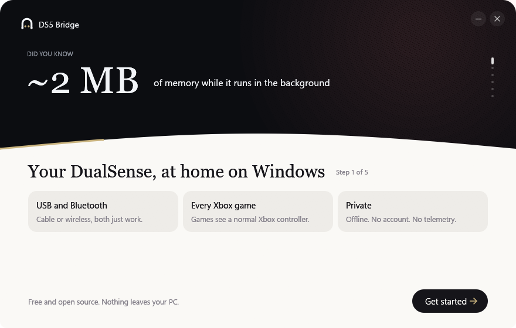
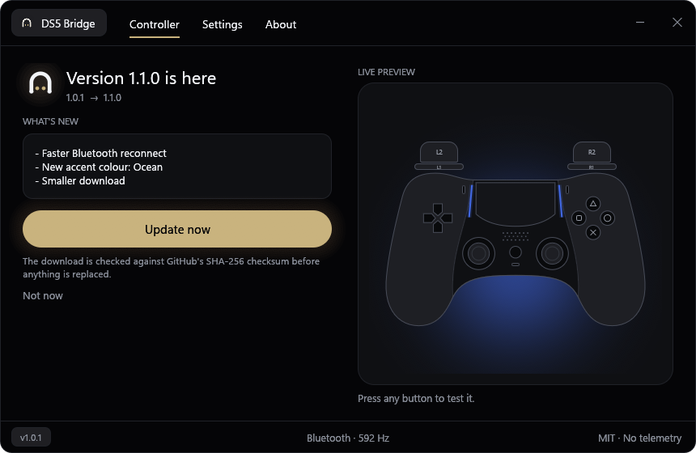

# DS5 Bridge


Connect a DualSense or DualShock 4 over USB or Bluetooth. DS5 Bridge shows live input and can provide a virtual Xbox 360 controller for Windows games that expect one.

**Windows 10 or 11 · USB or Bluetooth · No account or telemetry**

## From setup to your first game

### 1. Install the bridge

Run `DS5Bridge.exe` and choose **Install**. Open **Options** if you want a desktop shortcut or want the bridge to start with Windows. If you enable Xbox 360 output and the app reports a missing virtual controller driver, install [ViGEmBus](https://github.com/nefarius/ViGEmBus/releases).

<details>
<summary>See the installer</summary>

<p align="center">
  
</p>

</details>

### 2. Connect your PlayStation controller

Use a USB cable, or hold **Create + PS** on DualSense or **Share + PS** on DualShock 4 until the light bar flashes and pair it in Windows Bluetooth settings. Open DS5 Bridge from its tray icon. The **Controller** tab shows the controller model, connection and live input.

### 3. Check your inputs and play

Press a button or move a stick to check the live preview. **Xbox 360 bridge** is off by default. If your game needs Xbox input, enable it in the **Controller** tab and wait for an Xbox slot to appear. You can close the window and keep playing. Turning the bridge off removes the virtual Xbox controller while the preview stays available.


*The screenshot shows demo connection values and the controller drawing included in the distribution build.*

## Make it yours

Start with **Auto** polling. If you want a fixed rate, choose **125, 250 or 500 Hz** on the Controller tab. The **New data** row shows how often fresh reports arrive. If a stick drifts while resting, increase the deadzone slightly.

<details>
<summary>See the appearance and language settings</summary>

Change the accent colour, language and sounds in **Settings**.


</details>

## Updates and privacy

Controller input and settings stay on your PC. The bridge works offline. When update checks are enabled, DS5 Bridge reads release information from GitHub. When you choose to install an update, DS5 Bridge compares the downloaded EXE with the release's **SHA-256 checksum** before replacing it.

<details>
<summary>See how an update looks</summary>



*The version and release notes shown here are examples.*

</details>

## Help and source code

- **Use it without installing:** run `DS5Bridge.exe --portable`.
- **The game sees no controller:** enable **Xbox 360 bridge** if the game expects Xbox input, then check ViGEmBus and the virtual slot.
- **The game sees two controllers:** check whether Steam Input or another remapper is reading the same pad.
- **Bluetooth keeps dropping:** remove the controller in Windows Bluetooth settings and pair it again.
- **Uninstall:** go to **Windows Settings → Apps → Installed apps → DS5 Bridge**.

<details>
<summary>Build and verify the package</summary>

```powershell
cargo test --locked --no-default-features
./tools/package.ps1 -Destination ./dist
```

The package contains `DS5Bridge.exe` and its SHA-256 file. The packaging script remaps build paths and scans the EXE for personal paths and email-like strings. The GitHub workflow validates the package when run manually. The repository owner handles publishing.

Update checks use the releases of `aywalh/ds5bridge`. A fork can set `DS5BRIDGE_UPDATE_REPOSITORY` (`owner/name`) at build time to use its own releases.

</details>

[MIT License](LICENSE) · DS5 Bridge is independent of Sony and Microsoft.
